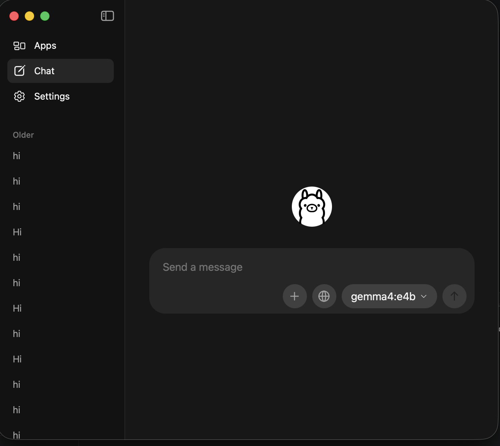
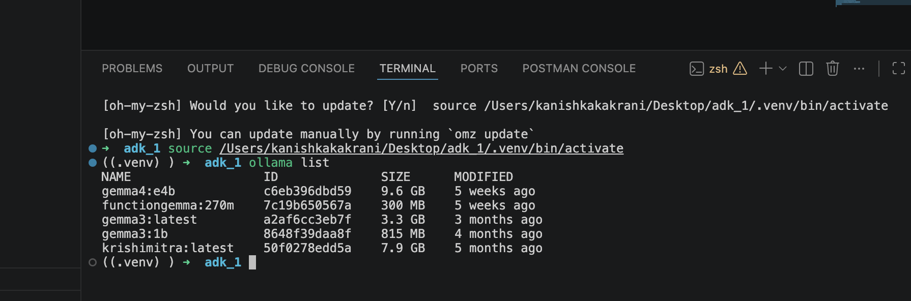

# Hands-on with Google Gemma: Build a Local CSV Analyst (Free, Private)

In this workshop you will download and run **Google Gemma** directly on your own laptop, and use it to build a private CSV Data Analyst. Everything runs on your machine — no cloud, no API key, and no cost.

Chatting with a local model is easy, but **Gemma 4** can do much more: it can call Python functions (tools), inspect real data files, and generate charts. To demonstrate this use case, we will run `gemma4:e4b` locally with **Ollama** and use **Google ADK** as a simple Python wrapper to connect Gemma to your CSV file.

**Model:** Gemma 4 (`gemma4:e4b`)  
**Time:** about 30 minutes  
**Level:** Beginner  

## What you will build

```
You ask a question
        |
        v
csv_orchestrator  (the manager)
   |            |
   v            v
csv_analyst   csv_report_agent
(numbers)     (summary + charts)
   |            |
   +-- read_csv tool --> st.csv
```

## What you will learn

- What **Google Gemma** is and why open local models matter
- How to download and run **Gemma 4 (`gemma4:e4b`)** on your laptop with **Ollama**
- How **Gemma's tool calling** lets a local model read files and create charts
- How to get reliable answers from a compact local model using focused roles and `temperature=0`

## Meet Google Gemma

**Gemma** is a family of lightweight, open AI models from Google DeepMind. It is built from the same research and technology used to create Google's Gemini models, but with open weights so you can download it and run it on your own hardware.

Gemma comes in different sizes. Compact sizes like **`gemma4:e4b`** (used in this workshop) run smoothly on a normal laptop. Larger sizes can run on a workstation GPU or Google Cloud.

### Why use Gemma?

| Benefit | What it means for you |
|---------|-----------------------|
| **Free to run** | No API key and no bill. Download the model once and use it as much as you want. |
| **100% Private** | Your CSV files and sensitive company or student data never leave your laptop. |
| **Works offline** | No internet connection needed after you download the model. |
| **Tool calling** | Gemma 4 can trigger your Python functions to read files, run calculations, or plot charts. |
| **Flexible** | Start locally on your laptop with Ollama, and deploy the exact same model to Google Cloud when you need scale. |

### Gemma or Gemini?

- **Gemma**: Open models you download, control, and run locally on your own machine for free.
- **Gemini**: Google's largest frontier models, accessed through a cloud API.

In this workshop we use **Gemma** because it gives you full privacy, zero cost, and hands-on control right on your laptop.

> **Tip for local models:** A compact laptop model has fewer parameters than a giant cloud model. To get the best results from local Gemma, keep instructions short and direct, set `temperature=0`, and split big jobs into focused tasks.

## Key words in 1 minute

| Word | Simple meaning |
|------|----------------|
| **Gemma (LLM)** | The AI "brain" running on your laptop that understands text and decides which tool to call. |
| **Ollama** | A free tool that downloads and runs open models like Gemma on your computer. |
| **Tool** | A normal Python function that Gemma can call (for example, to read a CSV file). |
| **Agent** | Gemma paired with clear instructions and a list of Python tools it can use. |
| **Sub-agent** | A focused Gemma setup (like number calculation vs. report writing) so the local model stays accurate. |
| **ADK** | Google's Agent Development Kit — the Python library we use in this use case to connect Gemma to tools and a web UI. |

---

## Step 1: Run Gemma Locally with Ollama

First, let's get **Gemma 4** running on your computer before writing any Python code.

1. Download and install Ollama from https://ollama.com
2. Open your terminal and pull `gemma4:e4b`:

```bash
ollama pull gemma4:e4b
```

You can also open the Ollama app and select `gemma4:e4b` directly from the model dropdown:



3. Verify that `gemma4:e4b` is ready on your machine:

```bash
ollama list
```



Once downloaded, `gemma4:e4b` runs locally at `http://localhost:11434` without needing an internet connection.

## Step 2: Set Up the CSV Use Case

Make sure you have **Python 3.10 or higher**.

1. Install the Python libraries:

```bash
pip install "google-adk[extensions]" pandas matplotlib
```

`[extensions]` includes `LiteLLM`, which lets Python talk directly to your local Ollama Gemma server.

2. Create the project folder:

```
my_project/
  csv_agent/
    __init__.py
    agent.py
    st.csv
    .env
```

**`__init__.py`** (one line to load your agent file):

```python
from . import agent
```

**`.env`** (points to your local Ollama server where Gemma is running):

```
OLLAMA_API_BASE=http://localhost:11434
```

**`st.csv`** (sample data for Gemma to analyze — you can also replace this with your own CSV):

```csv
name,age,city,salary
Asha,21,Gwalior,30000
Ravi,24,Indore,45000
Meera,22,Bhopal,38000
Kabir,26,Delhi,60000
Sana,23,Pune,42000
```

## Step 3: Give Gemma a Tool to Read the CSV

By itself, an AI model only sees the text you send it — it cannot open files on your disk. However, **Gemma 4 supports tool calling**: if you give it a Python function, Gemma reads the function's **docstring** to understand what the function does and calls it automatically when needed.

Open `agent.py` and write the `read_csv` tool:

```python
from google.adk.agents import Agent
from google.adk.models.lite_llm import LiteLlm

import pandas as pd
import os


def read_csv() -> str:
    """Read the st.csv file from the same folder as agent.py."""
    file_path = os.path.join(os.path.dirname(__file__), "st.csv")
    try:
        df = pd.read_csv(file_path)
        return df.to_string(index=False)
    except Exception as e:
        return f"Error reading CSV: {str(e)}"
```

**How Gemma uses this:** Always write a clear docstring (`"""Read the st.csv file..."""`). Gemma reads that sentence to decide when to call `read_csv()`.

## Step 4: Configure Gemma as a Data Analyst

Now let's connect `gemma4:e4b` to the `read_csv` tool and give it clear instructions for answering number questions:

```python
csv_analyst = Agent(
    name="csv_analyst",
    model=LiteLlm(model="ollama_chat/gemma4:e4b", temperature=0),
    description="Specialist agent for analyzing CSV data.",
    instruction="""
    You are a CSV Data Analyst.
    ALWAYS use the read_csv tool before answering any question about the CSV.
    Answer questions like averages, maximum, minimum, counts and comparisons.
    Use only the information returned by the read_csv tool.
    Do not invent information.
    """,
    tools=[read_csv],
)
```

Two important settings for local Gemma:

- **`ollama_chat/gemma4:e4b`** : Always use the `ollama_chat/` prefix (not plain `ollama/`). This uses Gemma's structured chat template so tool calls work cleanly without loops.
- **`temperature=0`** : Keeps Gemma's output steady and factual, which is essential when working with numbers and CSV rows.

## Step 5: Test Gemma in the Browser (Optional)

Temporarily add this at the bottom of `agent.py`:

```python
root_agent = csv_analyst
```

Run from `my_project/`:

```bash
adk web
```

Open http://localhost:8000, pick `csv_agent`, and ask Gemma:

> What is the average age?

You will see Gemma call `read_csv`, inspect the 5 rows, and calculate the exact average age. Remove the temporary `root_agent = csv_analyst` line before the next step.

## Step 6: Let Gemma Create Charts & Reports

Gemma can also pass arguments to a Python function — for example, choosing which column to plot and what chart type to use. Add `create_chart` near `read_csv`:

```python
import matplotlib
matplotlib.use("Agg")
import matplotlib.pyplot as plt


def create_chart(column: str, chart_type: str = "bar") -> str:
    """Create a chart for one CSV column and save it as a PNG file.
    chart_type can be 'bar', 'hist' or 'line'."""
    df = pd.read_csv(os.path.join(os.path.dirname(__file__), "st.csv"))
    if column not in df.columns:
        return f"Column not found. Available columns: {list(df.columns)}"
    out = os.path.join(os.path.dirname(__file__), f"{column}_{chart_type}.png")
    fig, ax = plt.subplots()
    if chart_type == "hist":
        df[column].plot.hist(ax=ax)
    elif chart_type == "line":
        df[column].plot.line(ax=ax)
    else:
        df[column].value_counts().plot.bar(ax=ax)
    ax.set_title(f"{column} ({chart_type})")
    fig.savefig(out)
    plt.close(fig)
    return f"Chart saved at {out}"
```

Now configure a second Gemma role focused on writing summaries and generating charts:

```python
csv_report_agent = Agent(
    name="csv_report_agent",
    model=LiteLlm(model="ollama_chat/gemma4:e4b", temperature=0),
    description="Specialist agent for creating summaries and reports from CSV data.",
    instruction="""
    You are a CSV Report Specialist.
    ALWAYS use the read_csv tool first.
    Then:
    1. Understand the columns.
    2. Find useful statistics.
    3. Write a short summary with key findings.
    4. Use the create_chart tool to make one chart for an important column.
    Use only information from the CSV. Do not invent information.
    """,
    tools=[read_csv, create_chart],
)
```

**Why split work across two Gemma roles?** Compact local models like `gemma4:e4b` perform much better when each prompt has a single, clear job instead of one long instruction trying to do everything at once.

## Step 7: Use Gemma to Route Questions

Finally, we use `gemma4:e4b` as the main entry point (`root_agent`) that reads the user's question and routes it to either the analyst role or the report role:

```python
root_agent = Agent(
    name="csv_orchestrator",
    model=LiteLlm(model="ollama_chat/gemma4:e4b", temperature=0),
    description="Main manager for CSV questions. Delegates to specialists.",
    instruction="""
    You are the CSV Orchestrator. You have two specialists:

    1. csv_analyst: calculations, averages, max/min, counts, comparisons.
    2. csv_report_agent: summaries, reports, key findings, charts.

    Do NOT analyze the CSV yourself. Send the request to the right specialist.

    Examples:
    "What is the average age?"        -> csv_analyst
    "Who has the highest salary?"     -> csv_analyst
    "Give me a summary of the CSV."   -> csv_report_agent
    "Create a report with a chart."   -> csv_report_agent
    """,
    sub_agents=[csv_analyst, csv_report_agent],
)
```

**Why few-shot examples matter for Gemma:** Including the 4 short examples in the instruction helps a compact model like `gemma4:e4b` route questions with high accuracy.

## Step 8: Run and Test the Full Gemma System

```bash
adk web
```

Ask Gemma these questions in order:

| Question you ask | Which Gemma role answers |
|------------------|--------------------------|
| How many students are there? | `csv_analyst` |
| Which student has the highest salary? | `csv_analyst` |
| Give me a summary of the CSV with a chart | `csv_report_agent` |

Open the **Trace/Events** tab in the left panel to watch how `gemma4:e4b` routes your request, calls `read_csv` and `create_chart`, and writes the final response — all running locally on your laptop.


## Troubleshooting

| Problem | Fix |
|---------|-----|
| Cannot connect to Ollama | Check that Ollama is running: `ollama list` |
| Gemma model not found | Run `ollama pull gemma4:e4b` again |
| Gemma answers without calling the tool | Keep `temperature=0` and keep "ALWAYS use the read_csv tool" in the instruction |
| Wrong specialist is picked | Make the `description` of each role clearer |
| `csv_agent` not visible in the UI | Check `__init__.py` and run `adk web` from the parent folder |

## Ideas to try next with Gemma

1. **Try a bigger or smaller Gemma model:** Pull another Gemma size in Ollama, change the model name in `LiteLlm`, and compare speed and answers on your laptop.
2. **Bring your own CSV:** Replace `st.csv` with your own dataset and test what questions `gemma4:e4b` can answer.
3. **Add a data-cleaning role:** Create a third Gemma role that checks for missing values in the CSV.

## Learn more

- Google Gemma models on Ollama: https://ollama.com/library/gemma4
- Using Gemma with ADK: https://adk.dev/agents/models/google-gemma
- Using Ollama with ADK: https://google.github.io/adk-docs/agents/models/ollama
- Official Google codelab (Gemini + Gemma on Cloud Run): https://codelabs.developers.google.com/next26/multi-agent-system

---

*Created by Geeta Kakrani, Google Developer Expert (AI/ML).*
